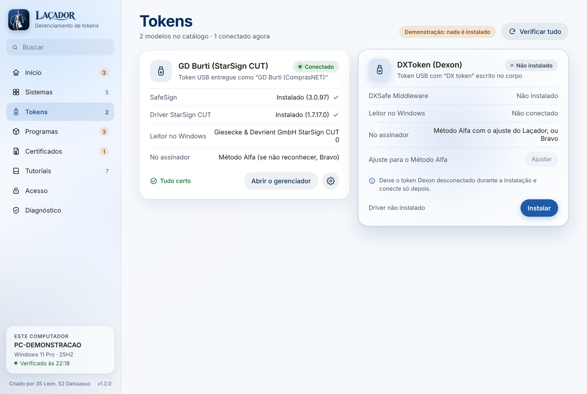
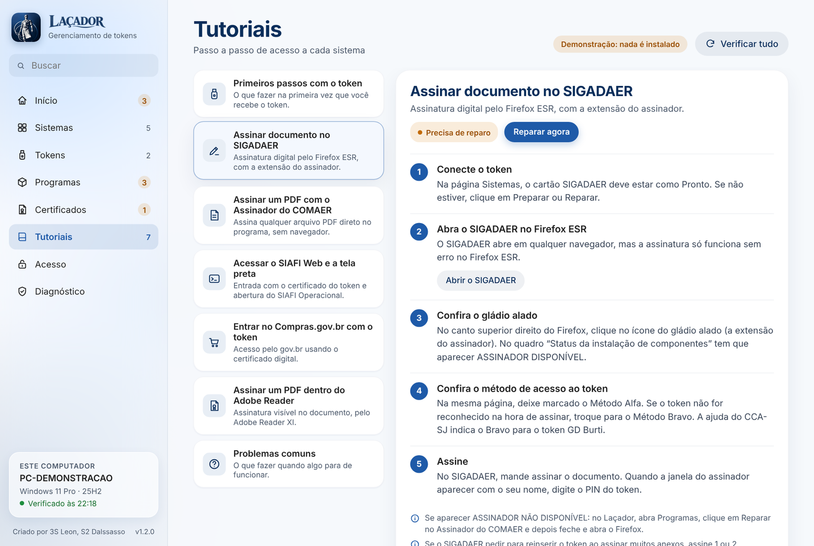

<div align="center">


# Laçador

**Sistema de gerenciamento de tokens de assinatura digital para Windows.**

Confere o computador, mostra o que falta para cada sistema funcionar e instala ou repara tudo com um clique, até para quem não é administrador.


</div>

## O problema

Na Base Aérea, assinar um documento no SIGADAER, assinar um PDF, entrar no SIAFI ou no Compras.gov.br depende de uma corrente inteira funcionando: o driver do token certo, o middleware, o Assinador, o Firefox certo com a extensão instalada **e fixada na barra**, a versão certa do Java, o Adobe Reader... Quando um elo falha, o usuário fica parado e abre um chamado. E boa parte desses computadores é de usuários sem senha de administrador, ou são os computadores pessoais dos chefes.

Era um problema antigo, resolvido sempre na mão, máquina por máquina.

## A solução

O Laçador é **um único executável** que:

- **Confere o computador** e diz, sistema por sistema, se está pronto para usar o token, em linguagem de gente: "Faltam ajustes em 3 sistemas", "Seu certificado vence em 17 dias".
- **Instala e repara com um clique**: drivers dos tokens, Assinador, Firefox e extensão, Java, Adobe Reader, sempre na ordem certa.
- **Funciona sem senha de administrador**: o suporte libera o computador uma vez e, a partir daí, qualquer usuário instala e repara sozinho, com segurança.
- **Ensina**: uma área de tutoriais com o passo a passo de cada sistema, ligada ao estado real da máquina ("Precisa de reparo → Reparar agora").
- **Gera um relatório para o suporte** quando nada disso resolve.

Roda de qualquer lugar (pendrive, Área de Trabalho, pasta de rede), em modo portátil ou instalado, e também aceita comandos para ser distribuído por GPO.

## Telas

<table>
  <tr>
    <td colspan="2"></td>
  </tr>
  <tr>
    <td colspan="2" align="center">Início: a situação do computador, os avisos e "O que você precisa hoje?"</td>
  </tr>
  <tr>
    <td></td>
    <td></td>
  </tr>
  <tr>
    <td align="center">Tokens conectados e o que cada um precisa</td>
    <td align="center">Tutoriais ligados ao estado da máquina</td>
  </tr>
</table>

> As telas mostram o **modo de demonstração**, com um computador e um usuário fictícios. Nada é instalado.

## Como funciona por dentro

```
Lacador.exe ─┬─ lançador nativo em C (tela de abertura em GDI+, extração segura)
             └─ .zip anexado: programa + catálogo + instaladores
                   │
                   ▼
   Lacador.ps1 ── servidor local em 127.0.0.1, com chave sorteada a cada abertura
        │                │
        │                └─ interface em HTML/CSS/JS (janela em modo aplicativo)
        ▼
   Lacador.Motor.psm1 ── lê o computador, calcula o estado e o plano de instalação
        │
        ▼
   Lacador-Agente.ps1 ── tarefa agendada como SYSTEM: instala para o usuário comum
```

- **Orientado a catálogo.** Tokens, programas e sistemas ficam descritos em `catalogo.json`: o que cada sistema exige, como detectar cada programa, como instalar em silêncio. Para suportar um token novo, basta acrescentar o item no catálogo.
- **Segurança em primeiro lugar.** A tela só conversa com o próprio computador, com uma chave nova a cada abertura. O usuário nunca envia caminho nem comando ao agente, só o nome de um item do catálogo, e o catálogo fica numa pasta que só o administrador altera. Cada instalador é copiado para uma pasta protegida e conferido pelo **SHA-256** antes de rodar: arquivo trocado ou corrompido não é executado.
- **Um executável só.** O lançador em C lê o próprio arquivo, encontra o `.zip` anexado no fim, valida os nomes e extrai o programa, enquanto mostra a tela de abertura com o progresso real.
- **Compatível com o Windows de verdade.** O motor roda no PowerShell 5.1, que vem em todo Windows 10 e 11, sem exigir nada instalado.

## Testes

- `testes/teste-motor.ps1`: 150 verificações automáticas do motor (cálculo do estado, plano de instalação, validação dos pedidos), rodando sobre cenários reais de máquinas em `testes/cenarios/`.
- `testes/ui/`: testes de interface com Playwright, de ponta a ponta, sobre a emulação.
- `emulacao/`: a interface real do Laçador ligada a um simulador do serviço local, para ver e testar todas as telas em qualquer sistema.

```bash
# Testes do motor (PowerShell 7 ou 5.1)
pwsh testes/teste-motor.ps1

# Monta a emulação: estados calculados pelo motor + interface real
pwsh emulacao/gerar-estados.ps1 -Programa Lacador/programa -Saida emulacao/estados.json
python3 emulacao/montar.py Lacador/programa emulacao
# depois é só abrir emulacao/previa.html no navegador
```

## Como compilar

```bash
# 1. Lançador nativo (MinGW-w64)
./lancador/compilar.sh

# 2. Executável completo: lançador + programa + instaladores
python3 construir.py --pacotes pasta/com/os/instaladores

# ou só o programa, sem os instaladores (cerca de 1 MB)
python3 construir.py --sem-instaladores
```

Os instaladores dos tokens e programas são de terceiros e **não fazem parte deste repositório**. O `construir.py` confere cada um pelo SHA-256 do catálogo antes de colocá-lo dentro do executável.

## Estrutura

| Pasta | Conteúdo |
|---|---|
| `Lacador/programa/` | Serviço local, motor, agente, catálogo, tutoriais e a interface (`interface/`) |
| `Lacador/ferramentas/` | Instalação para todos os usuários e preparação dos pacotes |
| `lancador/` | Lançador nativo em C e a tela de abertura |
| `testes/` | Testes do motor, cenários e testes de interface |
| `emulacao/` | Simulador do serviço local para rodar a interface fora do Windows |
| `construir.py` | Monta o `Lacador.exe` final |

Manual de uso completo em [Lacador/LEIA-ME.txt](Lacador/LEIA-ME.txt).

---

Criado por **Ivan Leon** (3S Leon) e S2 Dalssasso · [github.com/ivanleons](https://github.com/ivanleons)
